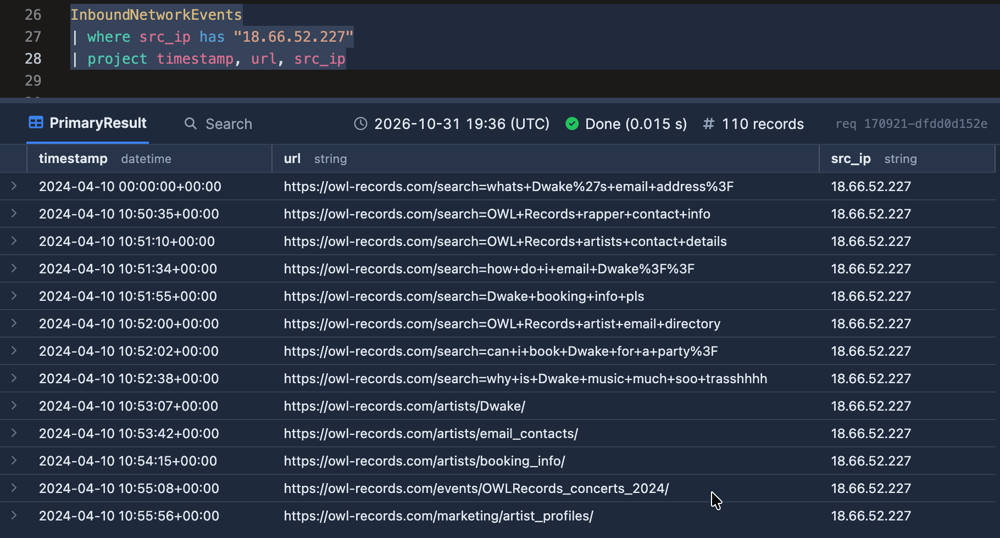
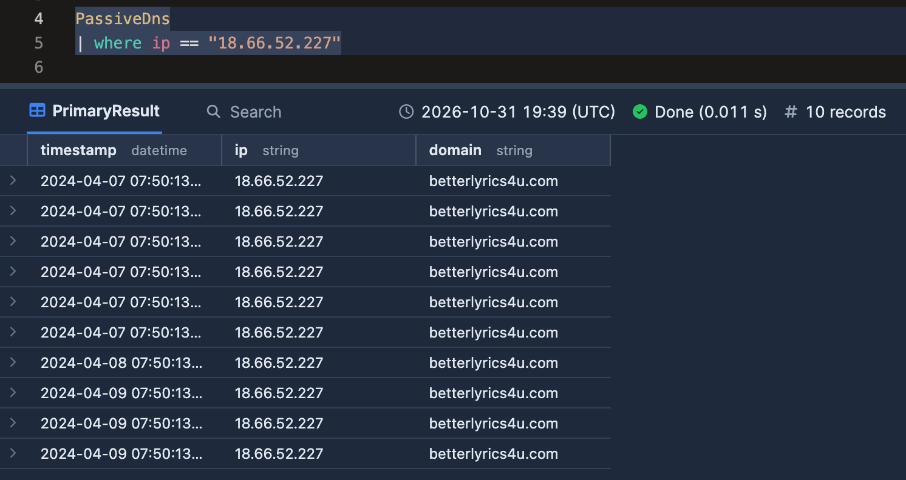
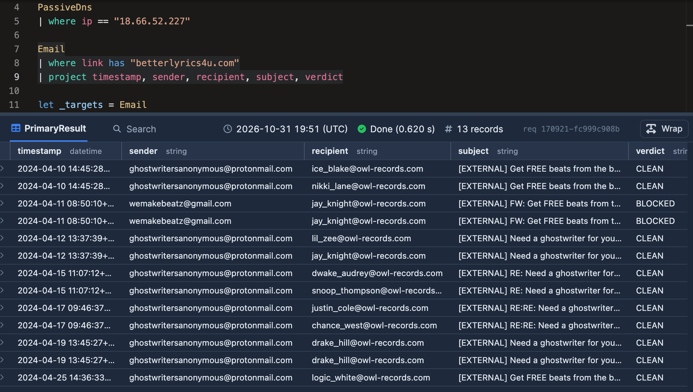
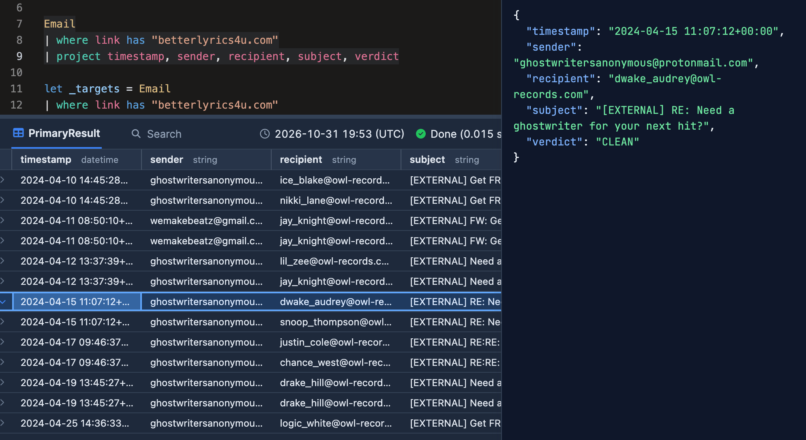
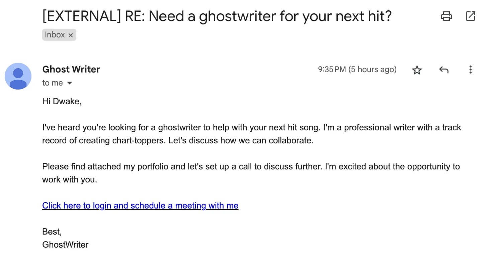
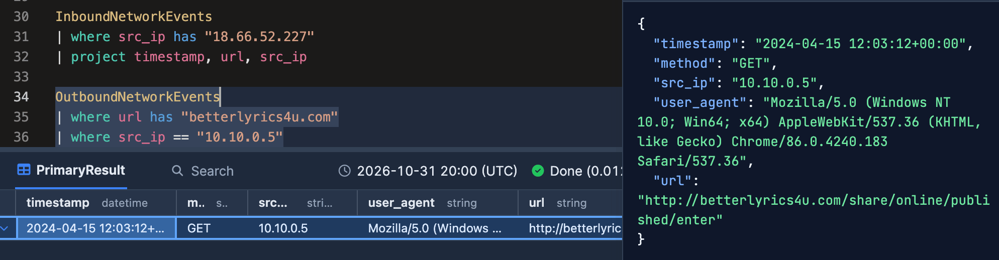
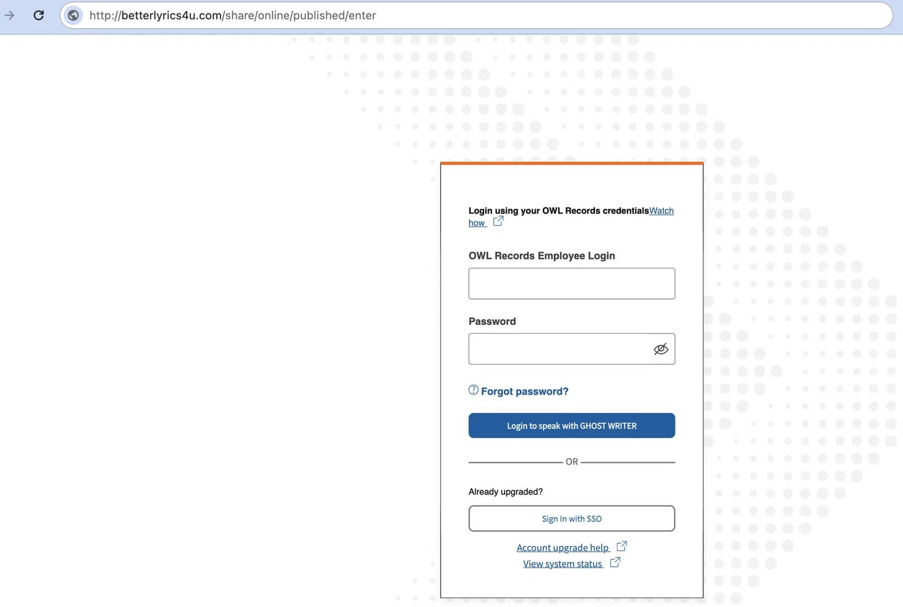
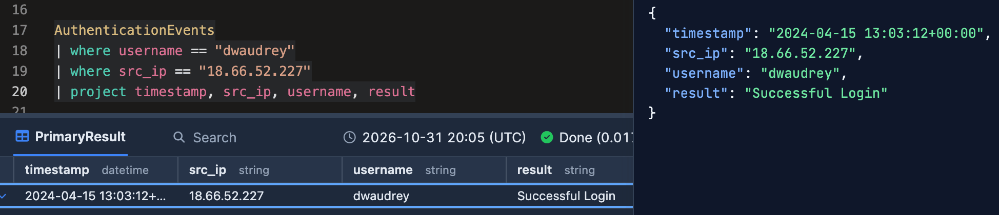
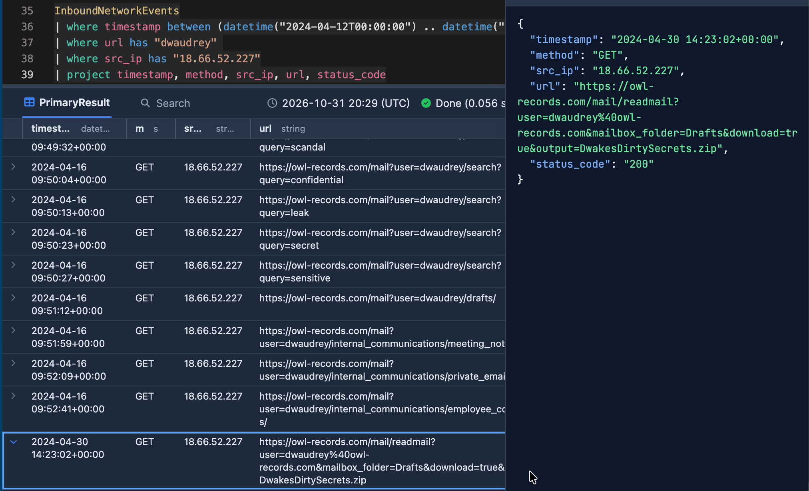

# KC7 Incident Report

- **Ticket Number:** SOC-2026-10492
- **Assigned Analyst:** A. Santos
- **Incident Type:** Spearphishing Campaign
- **Severity Level:** High
- **Affected Endpoint:** `OQPA-DESKTOP` (IP: `10.10.0.3`)
- **Affected User:** `dwaudrey`  (VIP/Executive Account)

---

## 1. Executive Summary

On October 30, 2024, an attacker downloaded sensitive information from user `dwaudrey`'s webmail using legitimate user credentials, which were harvested through a fake web portal delivered via phishing link. 

The spearphishing incident began with 13 emails sent to 10 publicly available employee email addresses. User `dwaudrey` interacted with a malicious link embedded in the email, which opened a fake login page on the user's browser. The user entered their credentials, which the attacker used to log in to the webmail account, browse personal folders, and exfiltrate sensitive information.

The user's credentials have been reset, and the malicious domain, email addresses, and IP have been blocked. Recommendations include multi-factor authentication, data sanitization rules for all publicly available email addresses, and phishing awareness training for employees.

---

## 2. Incident Timeline
**2024-04-10 00:00:00+00:00 - 2024-04-10 13:02:47+00:00:** Inbound network event logs shows from attacker IP `18.66.52.227` searching for employee contact information.

The IP mapped to domain `betterlyrics4u[.]com` via PassiveDNS.

---

**2024-04-15 11:07:12+00:00 - 2024-04-15 11:07:12+00:00** – Attacker launched a multi-target phishing campaign and delivered 13 spearphishing emails originating from `ghostwritersanonymous@protonmail.com` and `wemakebeatz@gmail.com` to 10 company employees.

---

**2024-04-15 11:07:12+00:00** – Spearphishing email delivered to victim `dwakeaudrey@owl-records.com`.

---

**2024-04-15 12:03:12+00:00** — User `dwaudrey` (IP `10.10.0.5`)clicked the phishing link and visited the malicious URL, which opened browser-based credential harvesting tool disguised as a fake login page

---

**2024-04-15 13:03:12+00:00** — Successful login attempt to user's mail server from attacker IP.

---

**2024-04-16 09:49:32+00:00** — Attacker queries keywords including `scandal`, `confidential`, `leak`, `secret`, `sensitive` in the user's webmail.

---

**2024-04-30 14:23:02+00:00** — Attacker accessed the `Drafts` folder in the user's webmail and downloaded file `DwakesDirtySecrets.zip` .

---

## 5. Indicators of Compromise (IoCs)

- **Malicious Domain:** `betterlyrics4u[.]com`
- **C2 IPv4 Address** `18.66.52.227`
- **Sender Email:** `ghostwritersanonymous@protonmail.com`
- **Sender Email:** `wemakebeatz@gmail.com`

---

## 6. MITRE ATT&CK® Mapping

| Tactic               | Technique                                                        | Observed Activity                                                                               |
| -------------------- | ---------------------------------------------------------------- | ----------------------------------------------------------------------------------------------- |
| Reconnaissance       | T1594 (Search Victim-Owned Websites)                             | Searched company's website for user `dwaudrey`'s contact details.                               |
| Resource Development | T1608.004 (Stage Capabilities: Link Target)                      | Hosted fake credential-harvesting web portal with domain `betterlyrics4u.com`.                  |
| Initial Access       | T1566.002 (Phishing: Spearphishing Link - Credential Harvesting) | Delivered malicious link via `ghostwritersanonymous@protonmail.com` and `wemakebeatz@gmail.com` |
| Execution            | T1204.001 (User Execution: Malicious Link)                       | User `dwaudrey` clicked the embedded link in the email.                                         |
| Credential Access    | T1056.003 (Input Capture: Web Portal Capture)                    | Harvested user credentials using web portal from Resource development.                          |
| Stealth              | T1078.004 (Valid Accounts: Cloud Accounts)                       | Logged into user `dwaudrey`'s webmail using the harvested credentials.                          |
| Discovery            | T1083 (File and Directory Discovery)                             | Located and opened the Drafts mail folder.                                                      |
| Collection           | T1114.002 (Email Collection: Remote Email Collection)            | Executed targeted search queries `scandal`, `secret`, `leak` in the user's Drafts folder.       |
| Exfiltration         | T1041 (Exfiltration Over C2)                                     | Downloaded zip file via HTTP GET request (Status 200) over established web session.             |

---

## 7. Containment & Remediation Actions

- **Identity Protection:** Forced password reset, session termination, and OAuth token revocation for user `dwaudrey`.
- **Blocking:** Added domain `betterlyrics4u[.]com`, IP `18.66.52.227`, and email senders `ghostwritersanonymous@protonmail.com` / `wemakebeatz@gmail.com` to to security blocklists.
- **Tenant Egress:** Purged remaining phishing emails from all internal mailboxes.

---

## 8. Analyst Verdict & Recommendations

- **Verdict:** **True Positive**
- **Recommendations:**
  1. Enforce Multi-Factor Authentication (MFA)
  2. Conduct targeted phishing awareness training for employees.
  3. Establish data sanitization rules for company mailboxes.
